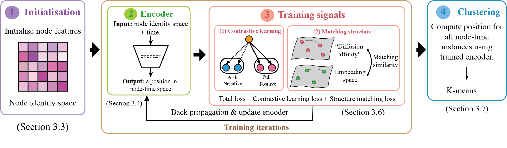

# Scalable dynamic community detection on temporal graphs

Code for *Scalable dynamic community detection on temporal graphs using graph neural networks* (Zhong, Mondragón, Clegg).



## Summary

The method assigns a community label to every observed **node-time instance** (u, t) of a link stream, so a node can change community over time. A TGAT encoder maps each node-time instance to an embedding. For each mini-batch, a centre time is sampled and a local **diffusion affinity matrix** is built from the time-weighted interactions around it. The encoder is trained with two signals derived from this matrix:

- **Contrastive learning**: pull together node-times with high diffusion affinity and push apart the rest.
- **Structure matching**: align pairwise similarities of the embeddings with those of CountSketch-compressed diffusion distributions.

After training, K-means on the node-time embeddings gives the dynamic communities. Unlike the original causal TGAT, the encoder uses neighbours on both sides of t, including interactions at t itself, because the task is offline clustering.

## Files

| File | Purpose |
|---|---|
| `dycommu-tgat.py` | Full pipeline: data loading, sampler, TGAT training, clustering, evaluation |
| `module.py` | TGAT encoder (`TGAN`) |
| `evaluation.py` | AMI / ARI for dynamic partitions |
| `p0.8_mu0.1_l5_1.csv` | Example synthetic link stream with ground truth |
| `run_example.sh` | Runs the example |

## Requirements

Python 3.10+ with `torch`, `numpy`, `pandas`, `scikit-learn`.

## Quick start

```bash
PYTHON=python bash run_example.sh
```

This trains on `p0.8_mu0.1_l5_1.csv` (about 2 minutes on a laptop CPU) and prints the AMI / ARI of the selected partition.

## Input and output

The input CSV needs `source`, `destination` (or `target`) and `timestamp` columns. Ground-truth labels go in `source_commu` and `destination_commu`, either in the input file itself or in a same-named file under `--ground-truth-dir`.

Each input gets a folder under `--output-root` containing:

- `node-time-communities.csv`: one community per (node, timestamp).
- `edge-partition.csv`: the same partition in the `evaluation.py` edge format.
- `best-model.pt`, `best-embeddings.npy`: the selected encoder and its embeddings.
- `pilot-search.csv`, `full-search.csv`, `summary.json`: per-checkpoint scores and the run summary.
- `node-id-map.csv`, `numeric-link-stream.csv`: the internal integer node ids used during training.

## Main options

| Option | Default | Meaning |
|---|---|---|
| `--n-clusters` | 13 | Number of communities K |
| `--temporal-configs` | `5:3,10:3,25:3,25:5` | `tau:cutoff` pairs to search; tau is in timestamp units, window = tau × cutoff |
| `--diffusion-order` | 2 | Random-walk steps in the diffusion matrix |
| `--local-loss-weight`, `--pairwise-loss-weight` | 1.0, 1.0 | Weights of the contrastive and structure-matching losses |
| `--full-epochs` | 10 | Training epochs per selected configuration |
| `--device` | `cpu` | `cpu`, `mps` or `cuda` |

Run `python dycommu-tgat.py --help` for all options.

> **Note on model selection.** The script tries each temporal configuration briefly, fully trains the best ones, and keeps the checkpoint with the highest AMI against the ground truth. Because the same labels are used for selection and for the reported score, the reported AMI is an optimistic estimate.
